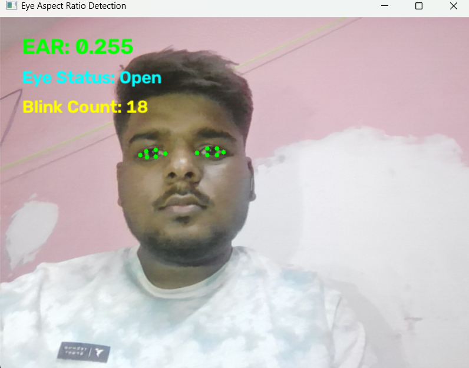

#  Eye Blink Detection Using Python

##  Project Description
This project detects eye movements and counts eye blinks in real time using a webcam. It uses OpenCV and MediaPipe Face Landmarker to identify facial landmarks and calculate the Eye Aspect Ratio (EAR).

##  Features
- Real-time face landmark detection.
- Detection of left and right eye landmarks.
- Eye Aspect Ratio (EAR) calculation.
- Eye status detection (Open / Closed).
- Automatic blink counting.
- Live webcam display.

##  Technologies Used
- Python
- OpenCV
- MediaPipe
- NumPy

##  Project Structure

```text
DDS/
│
├── main.py
├── face_landmarker.task
├── requirements.txt
├── README.md
│
└── screenshots/
    └── eye_detection.png
```

##  Installation

1. Clone this repository:

```bash
git clone YOUR_GITHUB_REPOSITORY_URL
```

2. Open the project folder:

```bash
cd DDS
```

3. Install the required libraries:

```bash
pip install -r requirements.txt
```

4. Make sure `face_landmarker.task` is present in the project folder.

##  How to Run

Execute the following command:

```bash
python main.py
```

Your webcam will open and start detecting eye landmarks.

Press **Q** to close the application.

##  Project Screenshot



##  Eye Aspect Ratio (EAR)

EAR is calculated using the vertical and horizontal distances between eye landmarks.

It helps estimate whether the eyes are open or closed.

##  Future Improvements
- Improve blink detection accuracy.
- Add a graphical user interface.
- Add more visual statistics.
- Explore additional facial landmark features.

##  Author
**Nikhil Raj**

CSE (AI & ML) Student

## 📄 License
This project is intended for educational and learning purposes.
